# Controlled Grounding DINO House Evaluation

This report describes one controlled synthetic evaluation of Grounding DINO Tiny. It is not a cross-detector comparison and does not validate a physical camera.

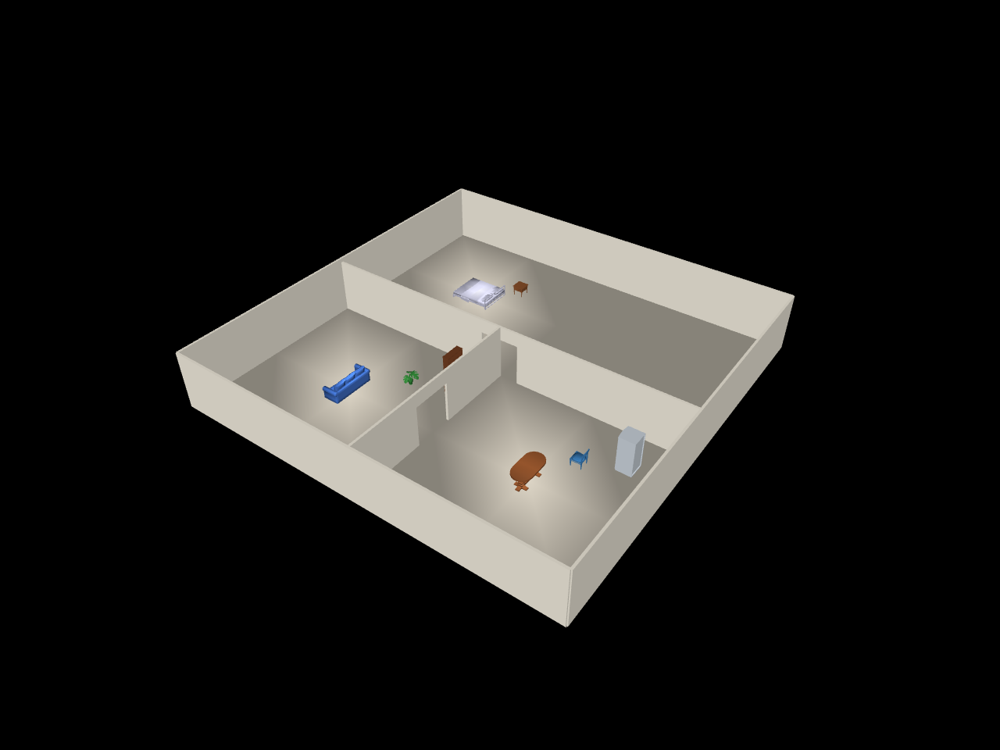

## Run summary

- Completed scenes: 216 / 216
- Reporting threshold: 0.35
- IoU threshold: 0.50
- Precision: 0.788
- Recall: 0.966
- F1: 0.868
- Pooled AP50: 0.965
- Class-mean AP50: 0.952
- False positives per image: 0.245
- Median matched IoU: 0.984
- Median inference time: 6.134 seconds

Inference times exclude model loading and rendering, include CPU output conversion, and were collected with concurrent development/verification activity. They describe this execution and are not an isolated hardware performance benchmark.

## Failure patterns

These counts are deterministic descriptions of this fixed batch. Each condition is paired with the baseline of the same asset, so baseline recognition difficulty is not confused with a condition-specific regression.

- distance:distance_1.5m: 3 new misses, 0 recoveries, +3 false positives versus the corresponding 12 baselines.
- focal_length:focal_700px: 2 new misses, 0 recoveries, +3 false positives versus the corresponding 12 baselines.
- occlusion:visible_25pct: 2 new misses, 0 recoveries, -2 false positives versus the corresponding 12 baselines.
- clutter:similar_shape: 0 new misses, 0 recoveries, +2 false positives versus the corresponding 12 baselines.
- clutter:mixed: 0 new misses, 0 recoveries, +1 false positives versus the corresponding 12 baselines.
- lighting:side: 0 new misses, 0 recoveries, +1 false positives versus the corresponding 12 baselines.
- lighting:dim: 0 new misses, 0 recoveries, -1 false positives versus the corresponding 12 baselines.
- occlusion:visible_50pct: 0 new misses, 0 recoveries, -1 false positives versus the corresponding 12 baselines.
- focal_length:focal_400px: 0 new misses, 0 recoveries, -2 false positives versus the corresponding 12 baselines.
- occlusion:visible_75pct: 0 new misses, 0 recoveries, -2 false positives versus the corresponding 12 baselines.
- viewpoint:azimuth_-90: 0 new misses, 0 recoveries, -2 false positives versus the corresponding 12 baselines.
- distance:distance_4m: 0 new misses, 0 recoveries, -3 false positives versus the corresponding 12 baselines.
- viewpoint:azimuth_+45: 0 new misses, 0 recoveries, -3 false positives versus the corresponding 12 baselines.
- viewpoint:azimuth_-45: 0 new misses, 0 recoveries, -3 false positives versus the corresponding 12 baselines.

Error categories at the fixed reporting threshold:

- background_fp: 21
- below_threshold_fn: 7
- duplicate_fp: 13
- localization_fp: 19

Duplicate false positives overlap an already matched instance at IoU >= 0.50. Localization errors have overlap but fail the matching rule. Below-threshold misses have a geometrically matching saved candidate below 0.35. No-saved-candidate misses are bounded by the 0.10 collection floor. Grounding DINO predictions are scored as returned, without study-specific NMS.

## Metric breakdowns

The lowest class recall was bed at 0.902. The lowest controlled-condition recall was distance:distance_1.5m at 0.750. The 12 target-absent controls produced 11 false positives.

Every miss at confidence 0.35 had a geometrically valid saved candidate below that threshold. In this batch, the fixed-threshold misses were confidence failures rather than complete proposal failures above the 0.10 collection floor.

### By class

| Group | Scenes | Precision | Recall | F1 | AP50 | FP/image |
|---|---:|---:|---:|---:|---:|---:|
| bed | 54 | 0.613 | 0.902 | 0.730 | 0.855 | 0.537 |
| chair | 54 | 0.911 | 1.000 | 0.953 | 1.000 | 0.093 |
| couch | 54 | 0.833 | 0.980 | 0.901 | 0.986 | 0.185 |
| dining table | 54 | 0.847 | 0.980 | 0.909 | 0.967 | 0.167 |

### By asset variant

| Group | Scenes | Precision | Recall | F1 | AP50 | FP/image |
|---|---:|---:|---:|---:|---:|---:|
| Bed_Bunk | 18 | 0.571 | 0.941 | 0.711 | 0.880 | 0.667 |
| Bed_King | 18 | 0.577 | 0.882 | 0.698 | 0.792 | 0.611 |
| Bed_Single | 18 | 0.714 | 0.882 | 0.789 | 0.949 | 0.333 |
| Chair_1 | 18 | 0.895 | 1.000 | 0.944 | 1.000 | 0.111 |
| Chair_2 | 18 | 0.944 | 1.000 | 0.971 | 1.000 | 0.056 |
| Chair_3 | 18 | 0.895 | 1.000 | 0.944 | 1.000 | 0.111 |
| Couch_Large1 | 18 | 0.615 | 0.941 | 0.744 | 0.897 | 0.556 |
| Couch_Medium1 | 18 | 1.000 | 1.000 | 1.000 | 1.000 | 0.000 |
| Couch_Small1 | 18 | 1.000 | 1.000 | 1.000 | 1.000 | 0.000 |
| Table_RoundLarge | 18 | 0.810 | 1.000 | 0.895 | 0.994 | 0.222 |
| Table_RoundSmall | 18 | 0.850 | 1.000 | 0.919 | 0.942 | 0.167 |
| Table_RoundSmall2 | 18 | 0.889 | 0.941 | 0.914 | 0.947 | 0.111 |

### By controlled condition

| Group | Scenes | Precision | Recall | F1 | AP50 | FP/image |
|---|---:|---:|---:|---:|---:|---:|
| distance:distance_1.5m | 12 | 0.600 | 0.750 | 0.667 | 0.867 | 0.500 |
| focal_length:focal_700px | 12 | 0.625 | 0.833 | 0.714 | 0.887 | 0.500 |
| occlusion:visible_25pct | 12 | 0.909 | 0.833 | 0.870 | 0.919 | 0.083 |
| baseline:baseline | 12 | 0.800 | 1.000 | 0.889 | 1.000 | 0.250 |
| clutter:mixed | 12 | 0.750 | 1.000 | 0.857 | 0.925 | 0.333 |
| clutter:similar_shape | 12 | 0.706 | 1.000 | 0.828 | 0.958 | 0.417 |
| distance:distance_4m | 12 | 1.000 | 1.000 | 1.000 | 1.000 | 0.000 |
| focal_length:focal_400px | 12 | 0.923 | 1.000 | 0.960 | 1.000 | 0.083 |
| lighting:bright | 12 | 0.800 | 1.000 | 0.889 | 0.982 | 0.250 |
| lighting:dim | 12 | 0.857 | 1.000 | 0.923 | 1.000 | 0.167 |
| lighting:side | 12 | 0.750 | 1.000 | 0.857 | 1.000 | 0.333 |
| occlusion:visible_50pct | 12 | 0.857 | 1.000 | 0.923 | 1.000 | 0.167 |
| occlusion:visible_75pct | 12 | 0.923 | 1.000 | 0.960 | 1.000 | 0.083 |
| viewpoint:azimuth_+45 | 12 | 1.000 | 1.000 | 1.000 | 1.000 | 0.000 |
| viewpoint:azimuth_+90 | 12 | 0.800 | 1.000 | 0.889 | 0.976 | 0.250 |
| viewpoint:azimuth_-45 | 12 | 1.000 | 1.000 | 1.000 | 1.000 | 0.000 |
| viewpoint:azimuth_-90 | 12 | 0.923 | 1.000 | 0.960 | 1.000 | 0.083 |

## Plots

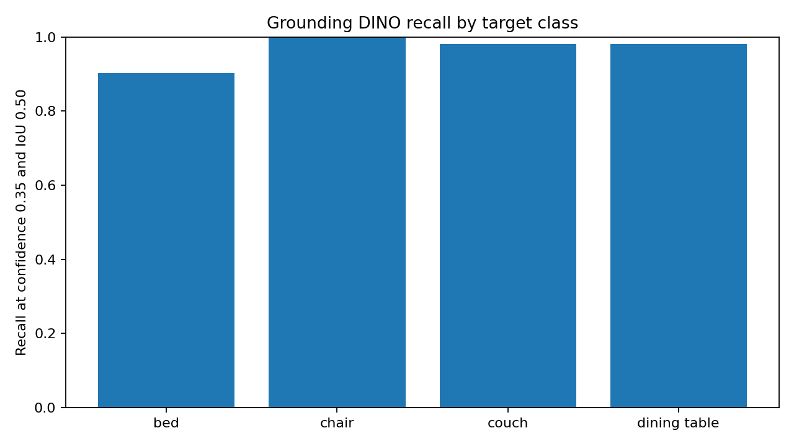

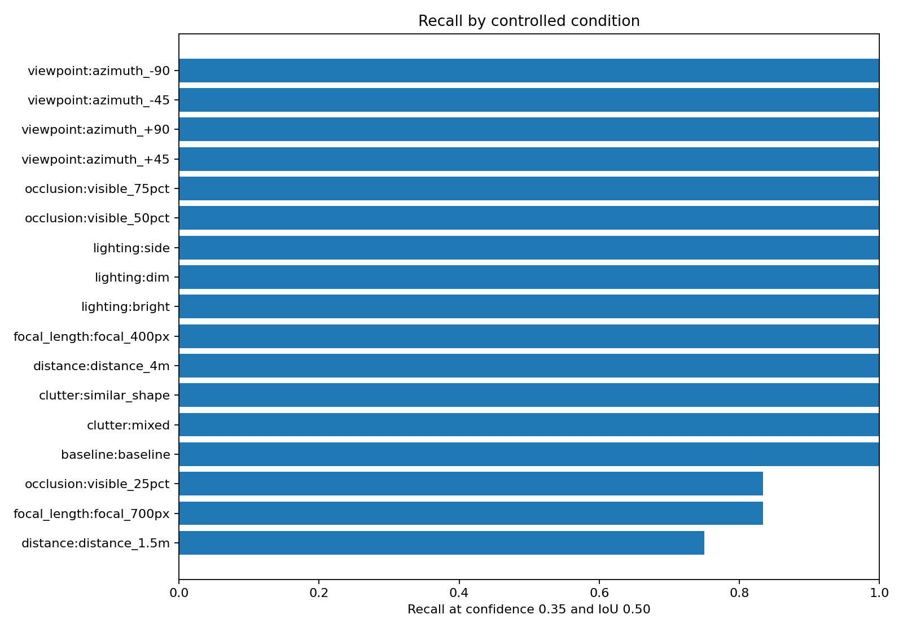

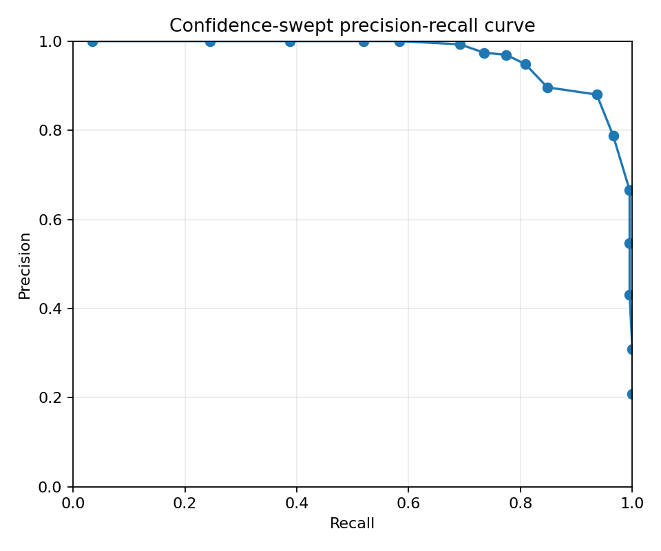

Detailed per-class, per-asset, and per-condition values are in `metrics.csv`. Machine-readable aggregate data is in `aggregate.json`.

AP uses every saved detection score and 101-point interpolated precision at IoU 0.50. Predictions below the collection threshold of 0.10 are unavailable. Class-mean AP averages the four per-class AP values; pooled AP ranks all predictions together. Conditions share asset variants and are paired observations, so this report does not claim independent statistical trials.

Ground-truth boxes enclose visible segmentation pixels. Under occlusion they are smaller than amodal whole-object boxes, which can penalize otherwise plausible whole-object detector predictions. Distance and focal changes may also cause image truncation; the recorded boxes and gallery expose that effect.

## Failure gallery

### scene_016_couch_focal_700px

couch, focal_length:focal_700px, TP=0 FP=3 FN=1

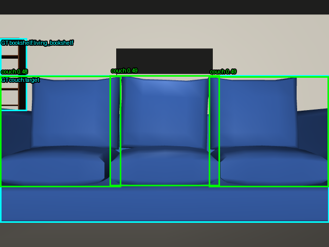

### scene_107_bed_distance_1.5m

bed, distance:distance_1.5m, TP=0 FP=2 FN=1

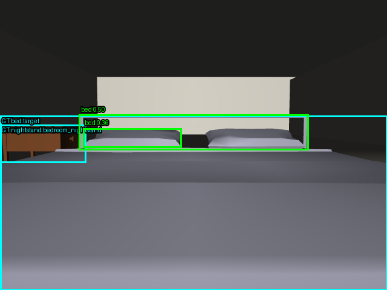

### scene_118_bed_focal_700px

bed, focal_length:focal_700px, TP=0 FP=1 FN=1

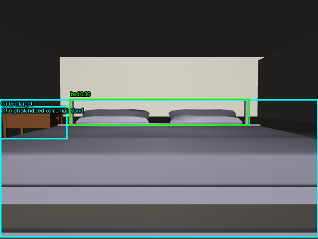

### scene_005_couch_distance_1.5m

couch, distance:distance_1.5m, TP=1 FP=3 FN=0

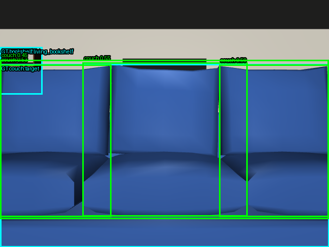

### scene_128_bed_visible_25pct

bed, occlusion:visible_25pct, TP=0 FP=0 FN=1

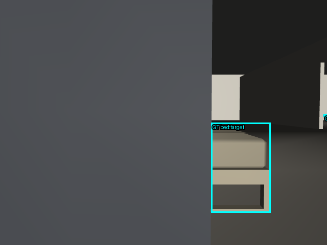

### scene_196_dining_table_visible_25pct

dining table, occlusion:visible_25pct, TP=0 FP=0 FN=1

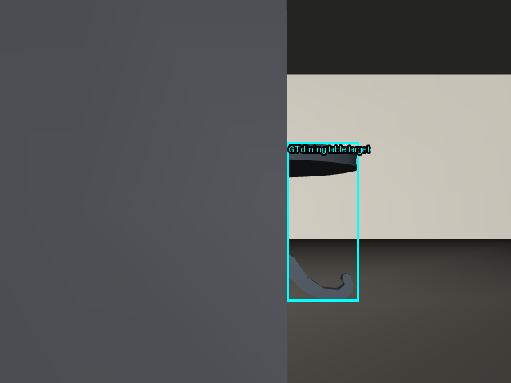

### scene_116_bed_similar_shape

bed, clutter:similar_shape, TP=1 FP=2 FN=0

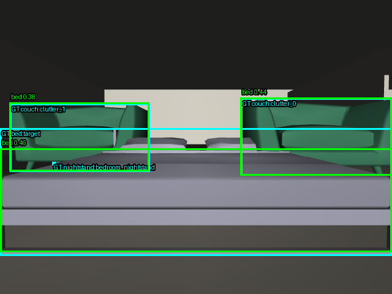

### scene_148_bed_side

bed, lighting:side, TP=1 FP=2 FN=0

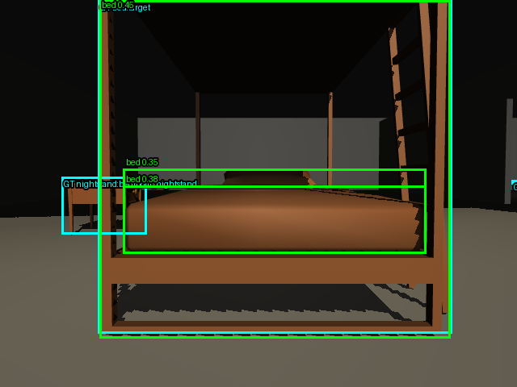

### scene_209_chair_absent_2

chair, target_presence:absent_2, TP=0 FP=2 FN=0

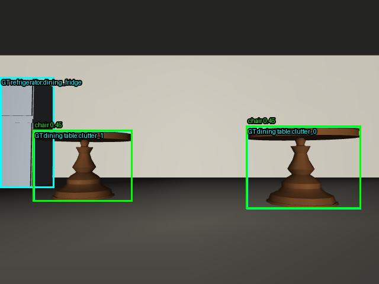

### scene_212_bed_absent_2

bed, target_presence:absent_2, TP=0 FP=2 FN=0

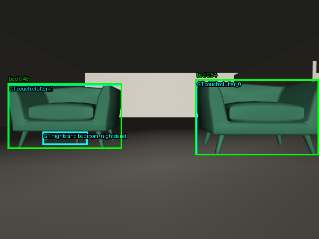

### scene_213_dining_table_absent_0

dining table, target_presence:absent_0, TP=0 FP=2 FN=0

### scene_000_couch_baseline

couch, baseline:baseline, TP=1 FP=1 FN=0

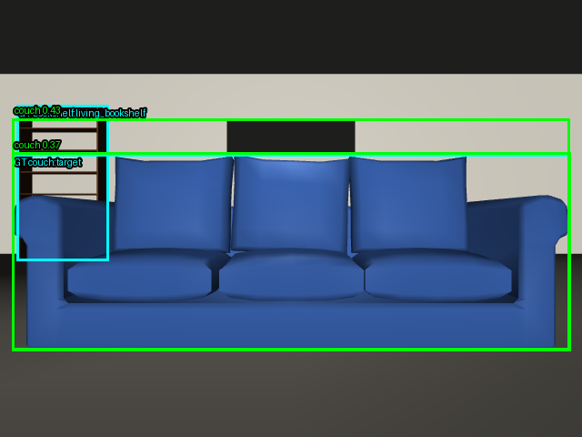
